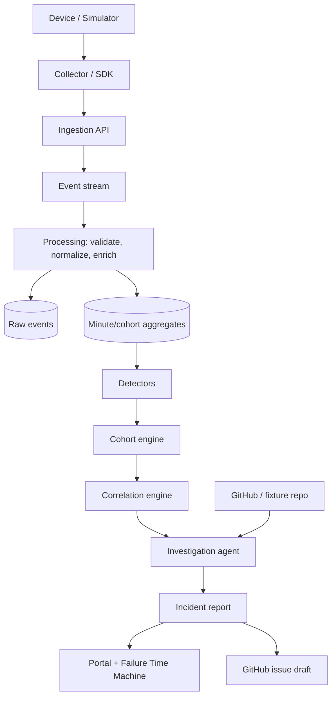

# OS Intelligence Lab

**AI-powered failure intelligence for complex software systems.**

Detect regressions. Discover affected cohorts. Correlate changes. Investigate source code. Explain what happened.

> *What changed, who is affected, why is it happening, and what should an engineer investigate next?*

```bash
make demo        # creates a venv, simulates 100,000 devices, finds the regression, opens the portal
```

Then open <http://127.0.0.1:8000/#/timemachine> and press **Play**.

## The flagship demo: ARM64 memory regression

Atlas 2.1 is rolled out to 20% of a 100,000-device fleet at 13:52. A memory defect makes ARM64 devices run out of memory. The ARM64 + App 2.1 cohort is only ~3.5% of sessions, so the fleet-wide failure rate barely moves (0.38% to 0.67%). The platform, with no hints about where to look:

1. Establishes a healthy baseline and notices the regression within minutes of the first affected sessions.
2. Scans every combination of up to three dimensions and isolates **ARM64 + App 2.1**: failure rate 0.40% to 8.50% (21x), 99% of the excess failures.
3. Ranks nearby changes: the Atlas 2.1 deployment scores 0.99, a driver update 43 minutes earlier scores 0.37, an OS update *after* the onset is excluded. Correlation, not causation.
4. Maps the release to a commit range and ranks seven commits; the deliberately injected `MemoryCache` change comes first and the failure signature `OOM_KILL|MemoryCache.Allocate` explains 99% of the excess.
5. Writes an investigation report that separates **observed facts** (computed by code) from **AI hypotheses** (validated against the evidence).
6. Lets you replay the whole incident in the **Failure Time Machine**.

```
13:52  Atlas 2.1 deployment started
13:53  First abnormal failure rate (estimated onset)
13:54  Statistical threshold exceeded
13:56  Anomaly confirmed · ARM64 + App 2.1 cohort isolated
13:58  5% of sessions exposed · correlation discovered (pipeline stages use a simulated clock)
14:00  GitHub commits analyzed
14:02  AI investigation completed
```

Exact minutes vary with the seed; run it and see.

## Quick start

```bash
make demo                         # one command: setup + simulate + analyze + serve
# or step by step
python3 -m venv .venv && .venv/bin/pip install -e ".[dev]"
.venv/bin/ail scenarios           # list the eight ground-truth scenarios
.venv/bin/ail demo                # simulate + analyze (no server)
.venv/bin/ail report AIL-1001 --db data/demo.db
.venv/bin/ail serve --db data/demo.db
```

Requires Python 3.10+. No Node, Docker or API keys are needed. Docker: `docker compose -f infrastructure/docker-compose.yml up --build`.

## What is in the box

| Capability | Where | How it works |
|---|---|---|
| Synthetic fleet simulator | [packages/simulator](packages/simulator) | Seeded populations, staged rollouts, injected regressions, traffic surges. Fully reproducible. |
| Ingestion API + SDK | [services/ingestion](services/ingestion), [packages/sdk](packages/sdk) | `POST /api/v1/events`, `/metrics`, `/deployments`; batching, per-item validation, de-duplication, back-pressure with `Retry-After`, optional bearer token. |
| Stream processing | `ail_ingestion.stream` | validate, normalize, enrich, aggregate to minute/cohort cells. In-memory stream behind an interface (Redis Streams / Kafka later). |
| Detector framework | [services/detection](services/detection) | Z-score, EWMA/CUSUM, change point, distribution shift, multivariate Mahalanobis. One `AnomalyResult` contract. All causal and confirm-gated. |
| Cohort intelligence | `ail_detection.cohort` | Expectation-based scan statistic over up to 3 dimensions; empirical-Bayes baseline hierarchy; penalises extra dimensions; "explain away" greedy ranking. |
| Correlation engine | `ail_detection.correlation` | Temporal proximity x excess-weighted population overlap. Changes after the onset score zero. |
| Investigation agent | [services/investigation](services/investigation) | Numbered evidence, provider-neutral LLM interface, deterministic offline provider, output validation that rejects invented numbers, commit hashes and uncited claims. |
| GitHub code intelligence | `ail_investigation.repos`, `codeintel` | Read-only compare/commit API client plus a heuristic commit ranker; issue drafts (and opt-in creation). |
| Portal | [apps/portal](apps/portal) | Command Center, Anomaly Explorer, Cohort Explorer, Investigation Workspace, Failure Time Machine. Dependency-free. |
| Local agent | [packages/agent](packages/agent) | `ail agent enroll / preview / run / revoke`. Sends only approved signals (heartbeat, CPU load, memory in use) in the same schema; refuses to run without consent. |
| Incident memory | `ail_investigation.history` | Remembers past incidents across runs; scores similarity by metric, cohort, failure signature and trigger type; cites recurrences as evidence. |
| Ask in English | `ail_detection.nlq` | `ail ask "regressions in the last 7 days affecting ARM64 but not x64"`, also in the portal. Shows how it understood the question. |
| Benchmarks | [docs/benchmarks/RESULTS.md](docs/benchmarks/RESULTS.md) | `ail evaluate` scores detection, cohorts, correlation and the agent against scenario ground truth. |



## Measured quality

From `ail evaluate` (8 scenarios x 3 seeds, 50,000 devices each; full table in [docs/benchmarks/RESULTS.md](docs/benchmarks/RESULTS.md)):

| Metric | Result |
|---|---|
| Incident precision / recall | 1.00 / 1.00 |
| False-positive rate on clean runs | 0 of 6 |
| Detection latency from effect start (median / max) | 4 / 5 minutes |
| Cohort identification (exact dimensions) | 17 of 18 |
| True change ranked top-1 | 18 of 18 |
| Agent reports passing grounding validation | 18 of 18 |
| Injected commit ranked first | 6 of 6 |

These are results on *synthetic* scenarios designed by the authors, so they show the engine does what it claims, not how it will do on your fleet. The one cohort miss (a global regression with a spurious small cohort on one seed) is left in the table on purpose.

## Principles

- **Privacy first.** No personal data in the schema; PII-looking custom dimension keys are rejected; demos use synthetic telemetry. See [docs/threat-model.md](docs/threat-model.md).
- **Evidence before AI.** Statistics produce every telemetry fact. The model may only explain, hypothesise and recommend, and its output is validated against the evidence before anyone sees it.
- **Cohort-aware.** A regression hitting 3.5% of sessions can be catastrophic for the cohort that holds them.
- **Reproducible.** Each incident stores its detection config hash and a data fingerprint; re-running yields the same incident.
- **Explainable.** Every result carries the detector, baseline, observed value, delta, severity, confidence and evidence.
- **Modular.** Detectors, stores, streams, LLM providers and repositories sit behind small interfaces.

## Using a real LLM

The default `rules` provider is deterministic and offline. Point the agent at any OpenAI-compatible endpoint (OpenAI, vLLM, Ollama, llama.cpp) or Azure OpenAI:

```bash
export AIL_LLM_PROVIDER=openai          # rules | openai | azure | local
export AIL_LLM_API_KEY=...              # never commit this
export AIL_LLM_MODEL=gpt-4o-mini
.venv/bin/ail analyze --db data/demo.db
```

If the model returns anything the validator rejects (an invented number, an unknown commit, an uncited claim, non-JSON), the report falls back to the rules provider and records why in `guardrail`. The HTTP providers are covered by mocked-transport tests; they have not been run against a live model in this repository's CI.

## Sending your own telemetry

```python
from ail_sdk import IngestionClient
client = IngestionClient("http://127.0.0.1:8000", token="...")
client.send_events([{"timestamp": "2026-03-10T12:00:30Z", "device_id": "d-1", "session_id": "s-1",
                     "os": "AtlasOS", "os_version": "12.4", "architecture": "arm64", "device_model": "Nova-A1",
                     "application": "Atlas", "application_version": "2.1", "driver_version": "7.14",
                     "event_type": "session", "failure_signature": None}])
```

`ail stream --devices 2000 --minutes 30` pushes simulated events through the SDK into a running server, and `POST /api/v1/analyze` runs detection on whatever has been ingested. The telemetry schema is in [docs/architecture/telemetry-schema.md](docs/architecture/telemetry-schema.md).

To send real signals from your own machine, use the opt-in agent (`ail agent enroll`, `preview`, `run`, `revoke`); see [docs/architecture/local-agent.md](docs/architecture/local-agent.md). To ask questions in plain English: `ail ask "regressions in the last 7 days affecting ARM64 but not x64"`.

## Roadmap status

| Phase | Status | Notes |
|---|---|---|
| 0 Foundation | Done | Docs, ADRs, threat model, CI, one-command build. Docker files are provided but were not built in the authoring environment. |
| 1 Telemetry playground | Done | Simulator, scenarios, ingestion API, store, aggregation, dashboard. |
| 2 Anomaly intelligence | Done | Five detectors, severity, evidence, reproducible results. |
| 3 Cohort intelligence | Done | Scan statistic and explorer; finds the injected cohort without hints. |
| 4 Change correlation | Done | Ranked candidates, presented as correlation. |
| 5 AI investigation agent | Done | Grounded, provider-neutral; offline provider by default. |
| 6 GitHub code intelligence | Partial | Read-only REST client, commit ranking, issue drafting. Not done: GitHub OAuth, repository picker UI, LLM-driven diff reading. |
| 7 Failure Time Machine | Done | Play, pause, accelerate, rewind, step, per-stage evidence. |
| 8 Real machine agent | Partial | Opt-in local agent with consent, preview and revoke; collectors for macOS (run and tested here), Linux and Windows (parsers tested on fixtures, not run on those systems). The exit criterion (two real operating systems sending data) has not been demonstrated. |
| 9 Intelligence platform | Partial | Done: historical incident retrieval and recurring-regression detection, failure-signature similarity, natural-language telemetry query. Not started: anomaly clustering, detector ensembles, adaptive baselines, forecast-based detection, dependency intelligence, automated experiment generation. |

Deliberate deviations from the suggested stack are recorded in [docs/adr](docs/adr): SQLite instead of PostgreSQL/Redis for the first cut, an in-memory stream instead of Redis Streams, and a dependency-free portal instead of Next.js.

## Recommended next steps

Ordered by value for the least effort. Items 1 to 4 close gaps in claims made above.

1. **Prove Phase 8 on a second OS.** Add a CI matrix job that runs `ail agent enroll --yes`, `preview` and a short `run` against a local server on `ubuntu`, `windows` and `macos` runners, then run the agent on a real Linux or Windows machine. Until then the Linux and Windows collectors are fixture-tested only.
2. **Run CI and the Docker build on GitHub.** The workflow and Dockerfile exist but have not run. Fix whatever breaks, then add a build badge.
3. **Exercise a real LLM.** Point `AIL_LLM_PROVIDER` at a live model, run `ail evaluate` with it, and record how often the guardrails reject or the fallback triggers. That turns the "grounded" claim from tested-with-mocks into measured.
4. **Record the demo.** A short capture of the Failure Time Machine plus two screenshots at the top of this README. The project is built to be shown.
5. **Finish Phase 6.** GitHub App or OAuth instead of a personal token, a repository picker in the portal, and LLM-assisted reading of the top candidate diffs (still validated against the evidence).
6. **Remove the fixed-baseline limit.** Add an adaptive (rolling or seasonal) baseline so a regression present from the start, a second episode on the same metric, and long-running fleets are handled. This is the most important detection gap; it also unlocks forecast-based detection and anomaly clustering from Phase 9.
7. **Tighten the one cohort miss.** The benchmark's single wrong cohort (a global regression on one seed) suggests the global-versus-cohort test needs a stricter threshold or an explicit "broad regression" check. Add more scenarios: overlapping regressions, two simultaneous deployments, a regression present from the start.
8. **Harden for exposure beyond localhost.** Authentication on read endpoints, per-client rate limiting, `pip-audit` and secret scanning in CI, dependency pinning.
9. **Scale the backend.** Implement `TelemetryStore` for PostgreSQL or ClickHouse and `EventStream` for Redis Streams, add an HTTP-level load test, and publish a benchmark for the 10 million stored events target.
10. **Portal quality.** Browser tests (Playwright) for the five views and the time machine, an accessibility pass, and a decision on whether to move to a framework (ADR 0005 describes the trigger).

The rest of Phase 9 (detector ensembles, dependency intelligence, automated experiment generation) is best tackled after item 6.

## Repository layout

```
apps/portal/            static portal (HTML/JS/SVG)
services/ingestion/     ingestion API, stream, processing, SQLite store
services/detection/     detectors, cohort engine, correlation, pipeline
services/investigation/ evidence, agent, LLM providers, GitHub, time machine
services/api/           combined HTTP API (ail_api) and CLI (ail_cli)
packages/schemas/       telemetry + result models, JSON Schemas
packages/sdk/           Python ingestion client
packages/agent/         opt-in local telemetry agent (ail agent)
packages/simulator/     synthetic fleet simulator
docs/                   PRD, architecture, ADRs, scenarios, benchmarks, threat model
infrastructure/         Dockerfile, compose
tests/                  unit and acceptance tests
```

## Development

```bash
make test       # 86 tests, ~40 s
make lint
make evaluate   # regenerate docs/benchmarks/RESULTS.md
```

See [CONTRIBUTING.md](CONTRIBUTING.md) and [docs/coding-standards.md](docs/coding-standards.md). MIT licensed.
