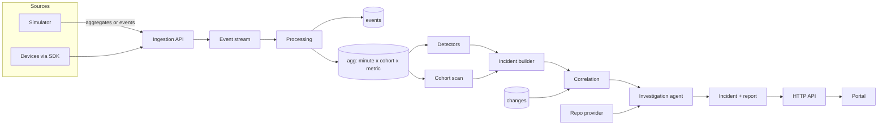

# Architecture overview

OS Intelligence Lab is a pipeline of small, replaceable stages. Statistics and deterministic code produce evidence; the AI layer explains it.

## Data model

Everything downstream reads a single dense structure: the **cube**, `(minute x cohort cell)` arrays of `n` (sessions or samples), `k` (failures), `s` and `ss` (sum and sum of squares of a gauge). A cohort cell is one combination of `os_version, architecture, device_model, application, application_version, driver_version`. A 100,000-device fleet collapses to 144 cells in the demo (a few hundred in general), so a 3-hour scenario is about 40,000 aggregate rows and every detector runs in milliseconds.

Metrics stored per cell: `failure_rate` (n, k), `latency_ms` and `memory_mb` (n, s, ss), and `sig:<signature>` (n) for failure signatures.

Raw events are stored as well when they arrive through the API (de-duplicated by event id). The simulator's fast path writes aggregates directly, which is what makes 100,000 devices practical; the event path is exercised by tests and `ail stream`.

## Detection flow

1. **Baseline.** The first `baseline_minutes` (60) of data fix a baseline level, a dispersion factor and, for gauges, a standard deviation.
2. **Detectors** run on the fleet-wide series for every metric. Each is causal (uses data up to minute *t* only) and an alarm must persist `confirm_minutes` to be kept.
3. **Cohort scan** runs every minute on a trailing window and alerts when the same significant cohort tops the scan on consecutive minutes.
4. **Incident builder** groups results by metric and by onset/cohort compatibility, then applies a practical-significance gate (statistical significance alone is not enough).
5. **Correlation** scores every recorded change.
6. **Investigation** builds evidence, asks the LLM provider for hypotheses, validates them and assembles the report and Failure Time Machine data.

Details and the reasoning behind each choice are in [detection-methods.md](detection-methods.md).

## Replaceable parts

| Part | Interface | Today | Next |
|---|---|---|---|
| Storage | `TelemetryStore` methods | SQLite | PostgreSQL, ClickHouse |
| Stream | `EventStream` protocol | in-memory deque + worker thread | Redis Streams, Kafka |
| Detector | `Detector.detect(ctx)` | five built-ins | drop in a class, add it to the list |
| LLM | `LLMProvider.complete` | rules, OpenAI-compatible, Azure | any |
| Repo | `RepoProvider.compare` | fixture, GitHub REST | GitLab, local git |

## Observability of the platform itself

`GET /metrics` exposes Prometheus text: `ail_ingest_events_total`, `ail_ingest_events_per_second`, `ail_ingest_rejected_total`, `ail_queue_depth`, `ail_processing_latency_seconds_*`, `ail_detector_latency_seconds_*`, `ail_detector_errors_total`, `ail_ai_request_latency_seconds_*`, `ail_ai_tokens_total`, `ail_investigation_duration_seconds_*`. Logs are structured JSON on stderr. `GET /health` reports queue depth.

## Failure handling

- Malformed events are rejected individually; the rest of the batch is accepted.
- Retries are safe: events are de-duplicated by id and aggregates are only updated for new events.
- A full queue returns `503` with `Retry-After`; the SDK backs off exponentially.
- A failing detector is logged and counted; the others still run.
- An invalid LLM answer falls back to the deterministic provider.
- The worker thread is drained on shutdown.

## Known limits

- One anomaly episode per metric per run (a second, later episode on the same metric is not separated).
- Baseline is a fixed warm-up window, so a regression present from the start is invisible to the baseline-based detectors.
- Single-node SQLite; the 100K+ events/s target needs the streaming and columnar-store work in the roadmap.
